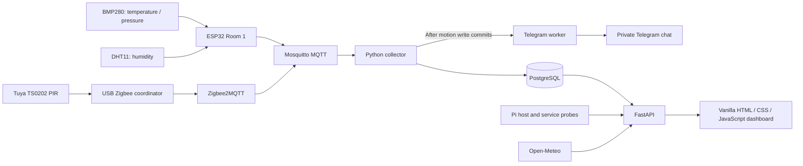

# Raspberry Smart Home

A Raspberry Pi 5 monitoring system that collects ESP32 environmental telemetry and Zigbee motion events, stores them in PostgreSQL, and presents them through a FastAPI dashboard. Telegram delivers motion detection and cleared notifications.

Developed for the Master's project:

> **Дослідження та реалізація апаратно-програмної системи розумного дому з функцією моніторингу руху на базі Raspberry Pi та ESP32**

**Status reviewed: 30 September 2026.** The deployed system reports healthy. ESP32 readings are fresh, the Zigbee2MQTT bridge is online, and both Telegram notification types have been verified with the Living room sensor. This is a deployment snapshot; the dashboard provides current health.

## Current functionality

| Module | Status | Implemented behavior |
| --- | --- | --- |
| Indoor environment | Working | BMP280 temperature/pressure and DHT11 humidity, published by ESP32 approximately every five seconds and stored in PostgreSQL |
| History | Working | Temperature/humidity/pressure switch, 1H/6H/24H ranges, min/max/average, trends, CSV export and fullscreen |
| Outdoor weather | Working | Open-Meteo weather for Lviv, including feels-like temperature, humidity, pressure, wind and precipitation; ten-minute cache and stale-data fallback |
| Room analysis | Working | Local comfort score, recommendations, anomaly detection, temperature trend and conditional 30-minute forecast |
| System Status | Working | Real CPU/RAM/disk usage, CPU temperature, uptime, hostname, MQTT, database, Internet and ESP32 freshness |
| Smart Home Map | Working | Separate `/topology` page with floating SVG device nodes, a prominent Pi hub, neutral protocol branches, live status and selectable detail panels |
| Zigbee motion | Working | Living room Tuya TS0202 occupancy/clear transitions, event history, today's detection count, battery, LQI and last-report time |
| Telegram notifications | Working | Formatted detection and cleared alerts, configurable display labels, persistent detection cooldown and asynchronous delivery |
| Zigbee dashboard | Partial | Configured coordinator device presence and one integrated motion sensor; full network discovery and mapping remain planned |
| Wi-Fi RSSI monitoring | Experimental; running | Standalone Linux script measures signal changes and writes to the systemd journal; separate from dashboard motion and Telegram |
| Wi-Fi CSI | Planned | No CSI capture or motion classification implemented |
| Camera, lighting and automation | Planned | Dashboard reserves space for modules; snapshot, network-map and automation controls are not operational |

Indoor telemetry, storage, motion history and room analysis run locally. Outdoor weather requires Open-Meteo access, and Telegram delivery requires Internet access. There is no Home Assistant or cloud AI dependency.

## Architecture



The collector groups separate temperature, pressure and humidity messages using a short batching window. Climate readings are stored in `sensor_readings`; motion uses `motion_sensor_state` and `motion_events`. Room analysis reads stored climate history through `room_analytics.py`.

## Deployment and hardware

| Component | Current deployment |
| --- | --- |
| Host | Raspberry Pi 5, 8 GB RAM; hostname `raspberry` |
| OS | Raspberry Pi OS deployment, Debian 13.5 (Trixie), ARM64 |
| Application | `/home/anton/smarthome`, Python virtual environment in `venv/` |
| Dashboard | `http://192.168.0.110:8000/` on the local network; address may change with DHCP |
| Climate device | ESP32-WROOM, BMP280 and DHT11; collector device ID `esp32-room1` |
| Motion sensor | Tuya TS0202 Zigbee PIR in the Living room |
| Coordinator | USB serial coordinator using TI Z-Stack; adapter `zstack`, 115200 baud |
| Stable coordinator path | `/dev/serial/by-id/usb-1a86_USB_Serial-if00-port0` |
| Zigbee2MQTT | Version 2.14.1, installed separately in `/opt/zigbee2mqtt` |
| MQTT broker | Existing local Mosquitto at `mqtt://localhost:1883` |
| Other hardware | Official Raspberry Pi PSU, Pironman 5 Mini case, Kingston Canvas Go! Plus 64 GB microSD |

The stable serial path currently resolves to `/dev/ttyUSB0`. The dashboard's System Status probe checks the configured device path; it does not perform a Zigbee protocol-health check. Zigbee2MQTT's retained `zigbee2mqtt/bridge/state` message independently reported `online` during this review.

### Latest verification

On 30 September 2026:

- All six services listed below were active; the System Status API returned `healthy`.
- A real stored climate reading at **21:35:21 Europe/Kyiv** contained **20.78 °C**, **57% humidity** and **997.2 hPa**. ESP32 telemetry was approximately one second old.
- The Living room PIR recorded detection at **21:31:53** and clear at **21:32:05**. Collector logs confirmed successful Telegram delivery for both transitions.
- Weather and room-analysis endpoints returned HTTP 200. Weather was fresh; anomaly detection, trend and forecast were available for the recorded history.
- The RSSI experiment was sampling `wlan0` and reporting signal measurements in its journal.

## Dashboard

The interface preserves the engineering theme, typography and dark/light mode with a saved theme preference. A reusable card template and CSS Grid provide:

- Three equal environment cards: temperature, humidity and pressure.
- A large history chart beside stacked Weather, AI Analysis and System Status cards.
- Full-width Motion, Automation, Camera and Zigbee sections.
- A separate **Smart Home Map** page at [`/topology`](http://192.168.0.110:8000/topology), linked from the dashboard, with compact selectable device icons and SVG connections.
- A twelve-column desktop layout, three sensor cards across on tablets, and a single-column mobile layout.

| Data | Refresh interval |
| --- | --- |
| Latest climate readings and PIR state/history | 5 seconds |
| Climate history and System Status | 10 seconds |
| Smart Home Map | 10 seconds while `/topology` is visible; no map polling on the main dashboard |
| Room analysis | 30 seconds |
| Outdoor weather | 10 minutes |

Chart metric changes reuse fetched history. CSV export includes timestamps and all three climate metrics for the selected window. The visible 7D and 30D controls are disabled. See [dashboard architecture](DASHBOARD.md) for component structure, responsive behavior and expansion guidance.

The map centers a prominent Pi computer icon above Wi-Fi/MQTT and Zigbee groups. Floating nodes use icon rings for selection and distinct keyboard focus; rounded neutral branches connect protocol labels to device icons. The canvas fills the available width and re-centers when the drawer opens. Nodes show their icon, name, room, health and active condition; readings appear only after selection. Click, tap, Enter or Space opens a right-side panel on desktop or a full-width panel below the map on mobile. Close or Escape returns focus to the device. The existing theme preference carries between pages, and old `/#topology` links redirect to `/topology`. Its backend returns extensible `nodes` and `links` arrays. It reuses the existing ESP32 freshness rule and system-health probes; a quiet PIR remains **Availability unknown**, with its last reported state and timestamp visible. Connection lines show communication relationships only; they stay neutral because telemetry freshness and broker reachability do not establish radio-link health. Device indicators and details retain the existing health and freshness information. This is a deployment map, not Zigbee mesh discovery.

## Motion and Telegram behavior

The collector records the first live occupancy state and subsequent transitions. Repeated reports update diagnostics without duplicating events. Retained MQTT snapshots do not create new detections. Today's count includes detection transitions only; clear transitions remain visible in history.

PIR occupancy is the **last reported motion state**, not continuous presence detection. The sensor's battery-powered reporting is not treated as a 15-second heartbeat. Reports during collection outages can be lost; PostgreSQL contains received events, not reconstructed history.

Telegram uses this layout with a bold heading. The timestamp below is illustrative; real messages use the Pi's local event time:

```text
🚨 Motion detected

📍 Location: Living Room
📡 Sensor: motion-room1
🕒 Time: 29.09.2026, 20:26
⚡ Status: Motion detected
```

A matching clear uses **✅ Motion cleared** in the heading and **Motion cleared** in the status field. Detection attempts have a 60-second per-sensor cooldown by default. A clear after a successfully sent detection bypasses that cooldown; suppressed detection cycles do not generate extra clears. Cooldown and pending-clear state survive collector restarts.

Messages are queued after the database write commits and sent by a separate worker. Delivery failures do not block MQTT collection. Telegram alerts are best effort: there is no durable notification outbox or replay of missed alerts. Display labels do not rename the Zigbee device or its MQTT topic.

See [motion integration](MOTION.md) and [Telegram setup and delivery behavior](TELEGRAM.md).

## API and MQTT

| Endpoint | Purpose |
| --- | --- |
| `GET /` | Dashboard |
| `GET /topology` | Interactive Smart Home Map page |
| `GET /docs` | Interactive FastAPI API documentation |
| `GET /api/sensors/latest` | Latest stored temperature, pressure and humidity reading |
| `GET /api/sensors/history?hours=1` | Climate history; integer `hours` from 1 to 24, with 1/6/24 exposed in the UI |
| `GET /api/analytics/room` | Comfort, anomaly result, temperature trend and forecast |
| `GET /api/weather/current` | Cached outdoor weather with freshness information |
| `GET /api/system/status` | Host metrics, service health, thresholds and aggregate status |
| `GET /api/topology` | Aggregate system status, configured nodes, telemetry, diagnostics, communication links and isolated data-source status |
| `GET /api/motion?hours=24&limit=20` | Last PIR state, diagnostics, today's detections and recent events; `hours` 1–168, `limit` 1–100 |

| MQTT topic | Payload |
| --- | --- |
| `home/climate/room1/temperature` | Numeric temperature in °C |
| `home/climate/room1/pressure` | Numeric pressure in hPa |
| `home/climate/room1/humidity` | Numeric relative humidity in % |
| `zigbee2mqtt/0xa4c138657fddb903` | JSON occupancy, battery, battery-low flag, voltage, tamper and link quality |
| `zigbee2mqtt/bridge/state` | Zigbee2MQTT bridge state |

ESP32 online status uses the latest database reading: less than 15 seconds old means online. Climate APIs currently select across the readings table without room/device filtering, and the collector is configured for one climate device and one PIR.

Room analysis runs locally with NumPy, pandas and scikit-learn: comfort rules, `IsolationForest` anomaly detection and linear-regression forecasting. Forecasts require sufficient data and acceptable fit; unavailable results are explicitly marked. System Status isolates probe failures and uses short TTL caches: five seconds for host/MQTT/database checks, 45 seconds for Internet and 30 seconds for coordinator presence. See [System Status](SYSTEM_STATUS.md) for thresholds and probe details.

## Configuration and operations

The application services load `/home/anton/smarthome/.env` through systemd. [.env.example](.env.example) documents the settings:

| Settings | Purpose |
| --- | --- |
| `DB_HOST`, `DB_PORT`, `DB_NAME`, `DB_USER`, `DB_PASSWORD` | Shared PostgreSQL connection |
| `MQTT_BROKER`, `MQTT_PORT` | Collector and broker-health target |
| `WEATHER_LAT`, `WEATHER_LON`, `WEATHER_LOCATION_NAME` | Outdoor weather location |
| `MOTION_SENSOR_TOPIC`, `MOTION_SENSOR_ID`, `MOTION_SENSOR_NAME`, `MOTION_SENSOR_ROOM` | One configured PIR sensor |
| `ZIGBEE_SERIAL_DEVICE` | Explicit coordinator path for host monitoring |
| `TELEGRAM_ENABLED`, `TELEGRAM_BOT_TOKEN`, `TELEGRAM_CHAT_ID` | Optional private Telegram destination |
| `TELEGRAM_COOLDOWN_SECONDS`, `TELEGRAM_SENSOR_LABEL`, `TELEGRAM_LOCATION_LABEL` | Alert throttling and display labels |

Keep `.env` private with mode `600`; it is excluded from Git. On a fresh configuration only, copy `.env.example` to `.env` and fill in deployment values. Preserve the existing file when updating the running system. No secrets belong in the README, source code or logs.

Dependencies are listed in [requirements.txt](requirements.txt). To update them in the existing deployment:

```bash
cd ~/smarthome
venv/bin/python -m pip install -r requirements.txt
```

| systemd service | Responsibility |
| --- | --- |
| `mosquitto` | Local MQTT broker |
| `postgresql` | Climate and motion storage |
| `smarthome-collector` | MQTT ingestion and Telegram worker |
| `smarthome-api` | FastAPI, dashboard and monitoring endpoints |
| `zigbee2mqtt` | Zigbee coordinator and MQTT bridge |
| `wifi-motion-monitor` | Standalone RSSI experiment |

```bash
# Inspect services.
systemctl status smarthome-api smarthome-collector mosquitto postgresql zigbee2mqtt wifi-motion-monitor --no-pager

# Restart the relevant application service after code/configuration changes.
sudo systemctl restart smarthome-collector   # Collection and Telegram changes
sudo systemctl restart smarthome-api         # API configuration or Python backend changes

# Follow logs or observe real Zigbee reports.
journalctl -u smarthome-collector -f
journalctl -u zigbee2mqtt -f
mosquitto_sub -h localhost -t 'zigbee2mqtt/#' -v

# Read live health and motion history.
curl http://localhost:8000/api/system/status
curl http://localhost:8000/api/topology
curl 'http://localhost:8000/api/motion?hours=24&limit=20'
```

Zigbee2MQTT configuration is separate at `/opt/zigbee2mqtt/data/configuration.yaml`. Joining is normally closed; pairing is managed through its CLI/MQTT interface. The application has no dependency on its web frontend.

This repository describes an existing deployment, not a complete provisioning package. The climate database schema, ESP32 firmware and most installed systemd unit files are not included. `api.py` currently uses `/home/anton/smarthome/static` as an absolute path. Motion tables have an explicit initializer documented in [MOTION.md](MOTION.md).

## Repository layout

```text
api.py                        FastAPI routes and static dashboard serving
mqtt_collector.py             Climate batching and Zigbee MQTT ingestion
motion_service.py             Motion schema, validation, persistence and queries
telegram_notifications.py     Message formatting, queue, cooldown and delivery
system_status.py              Cached host and dependency probes
topology_service.py            Device registry, topology model and cached read-only telemetry
room_analytics.py             Local environmental analysis
weather_service.py            Cached Open-Meteo client
wifi_motion_monitor.py        Experimental Wi-Fi RSSI signal-change detector
static/                       Shared CSS; dashboard index.html/app.js; map topology.html/topology.js/topology-page.js
systemd/                      Wi-Fi monitor service definition
tests/                        Backend tests and optional motion/map browser checks
requirements.txt              Python runtime dependencies
.env.example                  Credential-free configuration template
```

Detailed guides: [dashboard](DASHBOARD.md), [system monitoring](SYSTEM_STATUS.md), [motion](MOTION.md), [Telegram](TELEGRAM.md).

## Validation

The full backend run on **30 September 2026** passed **99 tests**, including isolated PostgreSQL integration tests and topology status/failure/cache coverage. Real detection and clear notifications were previously confirmed in Telegram. The topology endpoint was also checked against the Pi's real database and health probes.

```bash
cd ~/smarthome
venv/bin/python -m unittest discover -s tests -v

# Include PostgreSQL integration tests using the existing deployment settings.
set -a
. ./.env
set +a
RUN_MOTION_DB_TESTS=1 venv/bin/python -m unittest discover -s tests -v
```

PostgreSQL tests create and remove their own uniquely named schema. Telegram tests mock network calls and do not send fixture alerts. [tests/check_motion_browser.py](tests/check_motion_browser.py) provides optional Playwright/Chrome checks for themes, responsive motion states and API failure/recovery; browser tooling is separate from runtime dependencies.

[tests/check_topology_browser.py](tests/check_topology_browser.py) covers nine screen widths, both themes, navigation, isolated map polling, floating-node styling, neutral SVG endpoints/protocol labels, drawer centering/reflow, keyboard selection/focus, live detail updates, motion/clear feedback, reduced motion, freshness expiry, unavailable/partial data, recovery, empty/additional nodes and safe text rendering. Its JSON fixture uses mocked readings, never published telemetry. The existing motion browser suite also passes with the map on its separate page.

With optional Playwright installed and Chrome available, run:

```bash
python tests/check_topology_browser.py
python tests/check_motion_browser.py
```

Set `CHROME_PATH` to the Chrome/Chromium executable when it differs from the scripts' default macOS location. No browser tools are needed by the running dashboard.

## Remaining work

- Add room/device filtering and support additional ESP32 and Zigbee sensors.
- Monitor Zigbee device availability and bridge health in the dashboard; add discovery and Zigbee mesh mapping beyond the configured-device topology.
- Implement automation rules, smart lighting, notification schedules and camera snapshots.
- Research actual Wi-Fi CSI sensing. The RSSI experiment detects signal fluctuations and cannot reliably establish human motion or presence.
- Extend history beyond 24 hours with suitable aggregation and retention controls.
- Package database migrations, service definitions and ESP32 firmware for reproducible installation.
- Add backup/restore procedures, longer-term storage monitoring and controlled remote access.

The deployment is intended for a trusted LAN. Dashboard/API authentication, HTTPS and authenticated MQTT access controls need to be addressed before broader exposure. Keep credentials, private keys, database dumps and runtime state out of Git.
